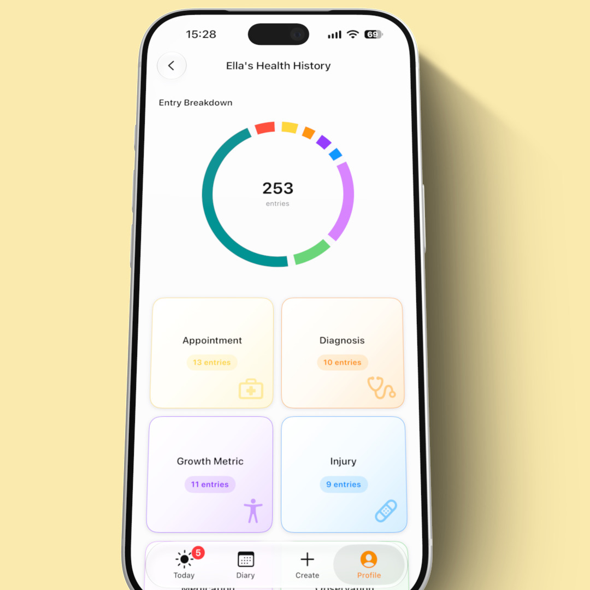
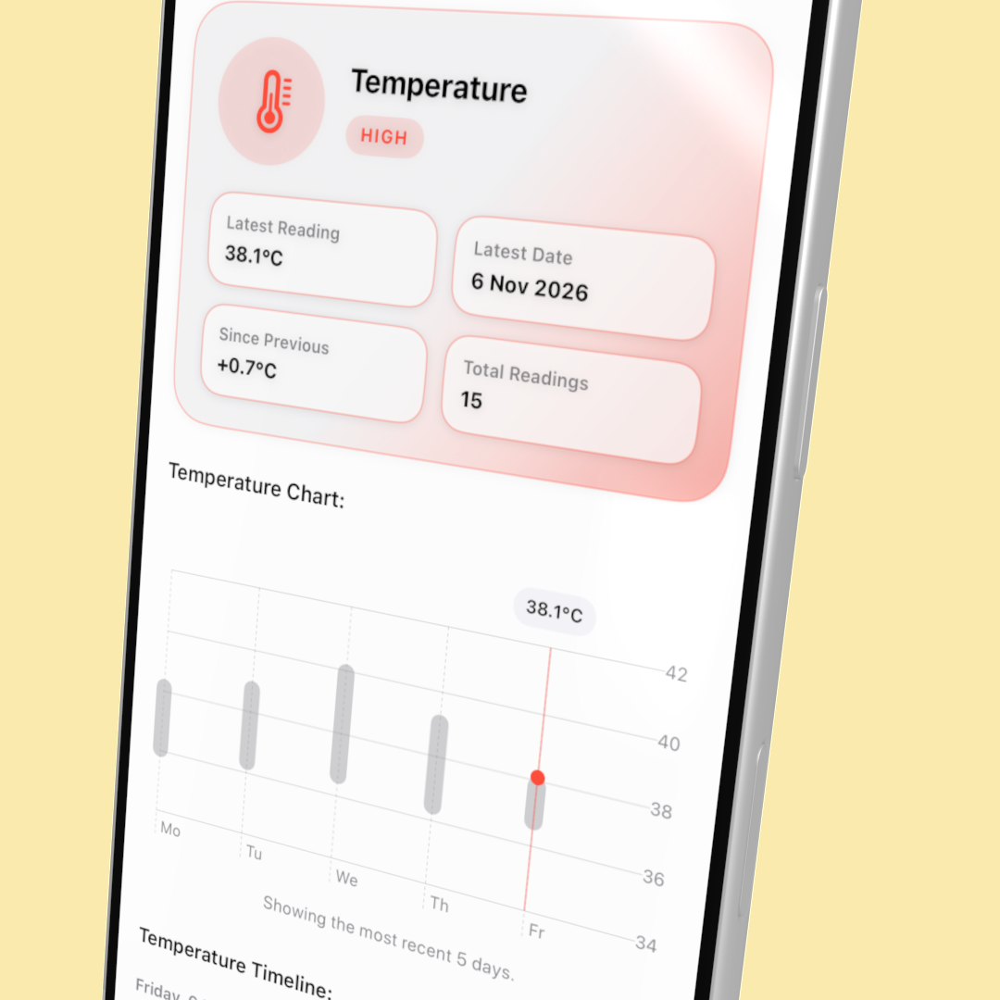
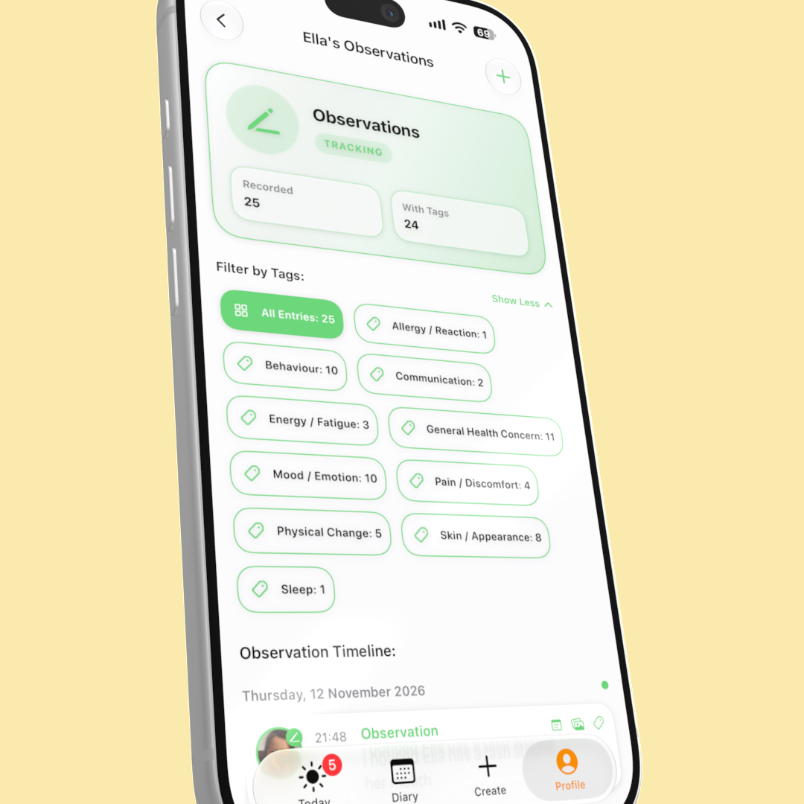

Keeping track of your family's health involves more than recording individual symptoms, temperatures or injuries. Sometimes, you need to step back and see the bigger picture.

That's why **History Views** are an important part of WellBee: Family Health Diary. They make it easier for parents to review previous health entries, track changes over time and keep related information together in one place.

<small>Originally Published: 30 September 2026 · Updated: 25 November 2026</small>

<!-- Main History Views feature image -->

## Bringing health history together

If you've used WellBee, you'll already be familiar with the Today tab, where ongoing health concerns appear front and centre.

Whether it's a diagnosis, injury, symptom or high temperature, the aim is to help parents quickly identify what needs their attention.

Previously, tapping an existing diagnosis or injury opened a dedicated history view, bringing together related entries, scheduled events and charts in one place. Symptoms and temperatures, however, took users straight to the edit screen.

**That experience has now become more consistent.**

Symptoms and temperatures gained their own dedicated history views, making it easier to review previous entries, track changes over time and see how an issue has developed.

<!-- Symptoms history screenshot -->

## The bigger picture, at a glance

These updates are about more than simply displaying past entries. They're about helping parents connect the dots, recognise changes over time and maintain a clearer record of their family's health.

When someone in the family is unwell, having the details organised in one place can make it easier to understand what's been happening and recall important information when it's needed.

## An evolving picture of family health

History Views have continued to evolve since their introduction. What began with dedicated views for diagnoses and injuries, followed by symptoms and temperatures, has now expanded across WellBee's wider health records.

<!-- Temperature history screenshot -->

This means parents can review more of their family's health information in dedicated history views, bringing related entries together and making it easier to see how things have changed over time.

The goal is to give every important part of a family's health history a clearer place, rather than leaving parents to piece everything together from individual entries.

## Continuing to improve WellBee

History Views are just one part of WellBee's ongoing development. The aim is simple: to make managing family health a little easier by giving parents a straightforward way to record, organise and review the information that matters.

**WellBee: Family Health Diary** is available on the App Store and its core features are completely free to use.
